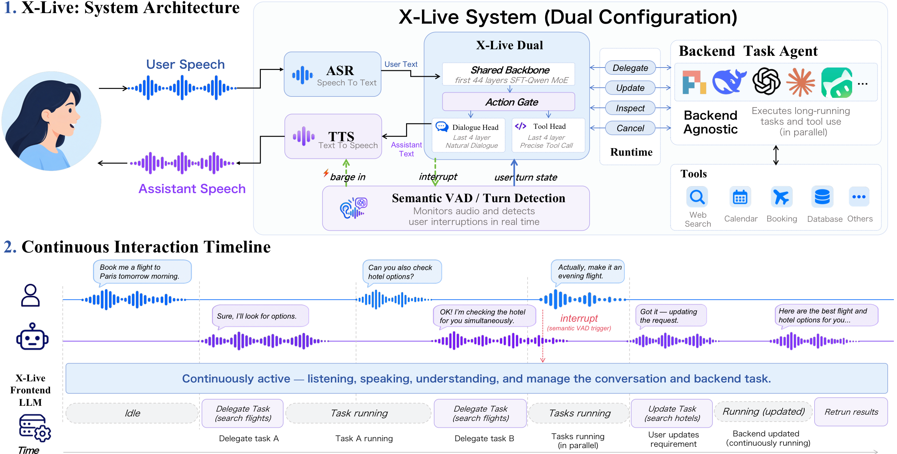
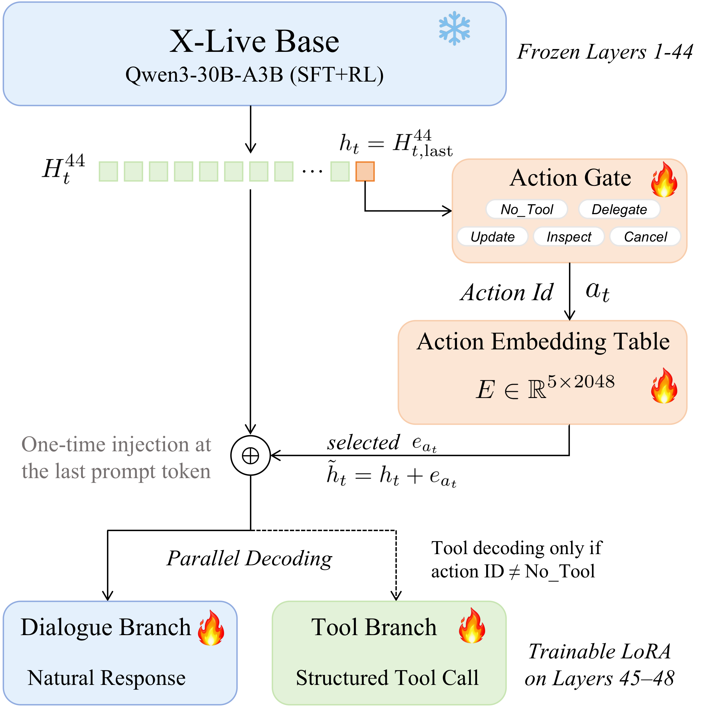

<div align="center">
  <p>
    
  </p>
  <p>
    <b>X-Live: Decoupling Speaking and Acting in Real-Time Voice Agent</b><br>
    Talk naturally, delegate tasks quickly, and stay in the conversation.
  </p>
  <p>
    <b>English</b> &nbsp;|&nbsp; <a href="README_zh.md">简体中文</a>
  </p>
  <p>
    <a href="https://hengtaowu.github.io/xlive/"></a>
    <a href="https://arxiv.org/abs/XXXX.XXXXX"></a>
    <a href="https://huggingface.co/HengtaoWu/X-Live-Base"></a>
    <a href="https://www.modelscope.cn/models/HengtaoWu/X-Live-Base"></a>
    <a href="https://huggingface.co/HengtaoWu/X-Live-Dual"></a>
    <a href="https://www.modelscope.cn/models/HengtaoWu/X-Live-Dual"></a>
    <a href="#install"></a>
  </p>
</div>

<a id="overview"></a>

## ✨ Overview

**X-Live System** is the real-time voice conversation system we built on
X-Talk for asynchronous AI agents. It couples a streaming speech cascade with a
conversational frontend model and an asynchronous agent runtime, so the
conversation continues while background work proceeds.

We train the frontend model, **X-Live Base**, from
Qwen3-30B-A3B-Instruct-2507 with SFT and RL. It sustains a natural
conversation while delegating and managing background tasks through native
tool calls. Users can keep talking, add requirements, inspect progress, or
cancel work while the agent is running; results are validated by the runtime
and expressed naturally by the model.

We further train **X-Live Dual** on top of X-Live Base. It decodes natural
language and structured tool calls in parallel and dispatches tasks more
precisely, so the system can handle more complex work while keeping the
conversation natural.

Inference in this repository defaults to the X-Live Dual configuration, with
Codex as the backend agent.

## 🚀 News

- **2026.11.20** We release X-Live Base, X-Live Dual, the inference framework, and AsyncVoiceBench.

## 🧠 System and Model Design

<div align="center">
<table>
  <tr>
    <td align="center" valign="top">
      
    </td>
    <td align="center" valign="top">
      
    </td>
  </tr>
</table>
</div>

<p align="center">
  <sub>Left: X-Live System architecture and interaction timeline. Right: X-Live Dual architecture.</sub>
</p>

## 🔥 Demo

<table>
  <tr>
    <td width="50%" align="center">
      <b>Travel Planning (English)</b>      
    <video src="https://github.com/user-attachments/assets/eaeb23cb-bf33-49f3-92c9-2e70ded998de" controls 
    preload="metadata" width="100%"></video>
      <br>
    </td>
    <td width="50%" align="center">
      <b>Travel Planning (Chinese)</b>
      <video src="https://github.com/user-attachments/assets/b4a2fca8-497a-4b74-af57-6e74fc6e32b1" controls preload="metadata" width="100%"></video>
      <br>
    </td>
  </tr>
  <tr>
    <td width="50%" align="center">
      <b>Teaching</b>
      <video src="https://github.com/user-attachments/assets/ea556eed-1cc2-470f-8da6-490d1dd967f8" controls preload="metadata" width="100%"></video>
      <br>
    </td>
    <td width="50%" align="center">
      <b>Multitasking</b>
      <video src="https://github.com/user-attachments/assets/d8277fc7-e728-4f37-b730-0cabfcc8a741" controls preload="metadata" width="100%"></video>
      <br>
    </td>
  </tr>
</table>

<a id="install"></a>

## 🛠️ Getting Started

### Hardware and System

Our reference deployment runs on a Linux server with **6 × NVIDIA RTX 4090
GPUs**. X-Live Dual uses four GPUs, Qwen3-ASR and Smart Turn share one GPU, and
Breeze TTS 2 uses one GPU.

### Setup

X-Live uses the official Codex CLI. Install it before running setup:

```bash
npm install -g @openai/codex
```

You can also point to your Codex binary explicitly:

```bash
export XLIVE_CODEX_BIN=/path/to/codex
```

```bash
git clone https://github.com/HengtaoWu/xlive.git
cd xlive
bash setup.sh
```

The setup script creates five isolated Conda environments under `.venvs/`,
configures the browser application, and checks the Codex CLI. Fixed defaults and
GPU assignments are documented in [Deployment settings](scripts/README.md).

### Download Models

```bash
bash scripts/download_models.sh
# Or use ModelScope
bash scripts/download_models.sh modelscope
```

The download command prepares both semantic VAD models. Runtime selection does
not require another model download.

### Launch

```bash
bash start.sh
```

The unified launcher starts Qwen3-ASR, Breeze TTS 2, Smart Turn, X-Live Dual
inference, the real-time runtime, and the web interface. When every service is
ready, open:

```text
http://127.0.0.1:8000
```

Smart Turn is the semantic VAD. Silero VAD provides fast acoustic speech
activity, and Smart Turn classifies candidate endpoints.

For the X-Live Dual architecture, we provide a [vLLM patch](src/xlive_vllm/)
for efficient inference.

This repository serves X-Live Dual for inference. The published Dual checkpoint
contains the complete X-Live Base backbone and all Dual-specific artifacts.

## 🧩 Customizing the Cascade

X-Live is a cascade voice agent built on Xtalk. Each stage is an independent
adapter, so you can replace one without touching the others.

| Stage | Default | Where to swap |
| --- | --- | --- |
| Speech recognition | Qwen3-ASR | `src/xlive/speech/asr/`, `QWEN_ASR_URL` |
| Semantic VAD | Smart Turn | `src/xlive/speech/turn_detector/`, `SMART_TURN_URL` |
| Speech synthesis | Breeze TTS 2 | `src/xlive/speech/tts/`, `BREEZE_TTS_URL` |

If a replacement service uses the same streaming protocol, update the service
address in `start.sh` (see [Deployment settings](scripts/README.md)).
The full-stack launcher also starts the local services; adjust those launch steps
when using an external service. Otherwise implement the `StreamingASRAdapter` / `TurnStateAdapter`
contract in `src/xlive/speech/contracts.py` and wire it in
`src/xlive/application.py`. The frontend model only needs an
OpenAI-compatible endpoint.

## AsyncVoiceBench

[AsyncVoiceBench](benchmark/README.md) evaluates conversation while background
tasks run, including updates, cancellations, multiple tasks and asynchronous result
delivery. It includes 100 English episodes, 456 recorded user utterances, a task
sandbox, a system-independent duplex audio runner and programmatic/LLM scoring. See its README for
setup, the seven metrics and evaluation limits.

## 🔖 Citation

Coming soon.

## 📄 License

X-Live source code is released under the [Apache License 2.0](LICENSE).
Third-party source code and model artifacts retain their respective license
terms. See the license files in the corresponding directories.

## 🙏 Acknowledgment

X-Live is made possible by the following open-source projects:

- [X-Talk](https://github.com/xcc-zach/xtalk)
- [Qwen3-30B-A3B-Instruct-2507](https://huggingface.co/Qwen/Qwen3-30B-A3B-Instruct-2507)
- [Qwen3-ASR](https://github.com/QwenLM/Qwen3-ASR)
- [Smart Turn](https://github.com/pipecat-ai/smart-turn)
- [Breeze TTS 2](https://github.com/breezeblue-ai/breeze-tts)
- [vLLM](https://github.com/vllm-project/vllm)

We thank the authors and contributors of these projects. Their source code,
model weights, and related artifacts remain subject to their original license
terms.
