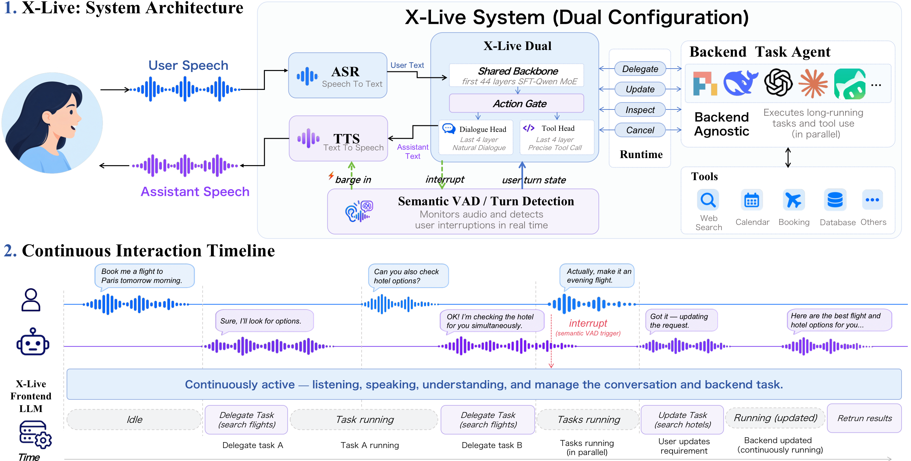
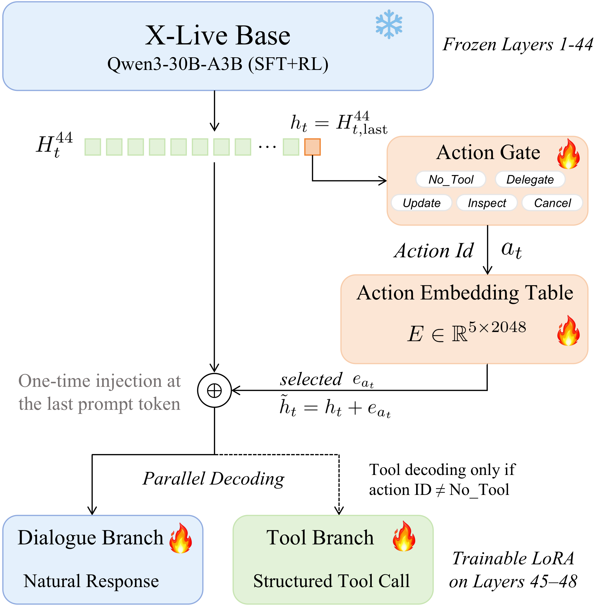

<div align="center">
  <p>
    
  </p>
  <p>
    <b>X-Live：解耦实时语音 Agent 中的说话与行动</b><br>
    自然交流、快速委派任务，并始终自然对话。
  </p>
  <p>
    <a href="README.md">English</a> &nbsp;|&nbsp; <b>简体中文</b>
  </p>
  <p>
    <a href="https://hengtaowu.github.io/xlive/"></a>
    <a href="https://arxiv.org/abs/XXXX.XXXXX"></a>
    <a href="https://huggingface.co/HengtaoWu/X-Live-Base"></a>
    <a href="https://www.modelscope.cn/models/HengtaoWu/X-Live-Base"></a>
    <a href="https://huggingface.co/HengtaoWu/X-Live-Dual"></a>
    <a href="https://www.modelscope.cn/models/HengtaoWu/X-Live-Dual"></a>
    <a href="#install"></a>
  </p>
</div>

<a id="overview"></a>

## ✨ 项目简介

**X-Live System** 是我们基于 X-Talk 构建的实时语音对话系统，面向异步 AI Agent。
它将流式语音级联、对话前端模型与异步 Agent 运行时结合在一起，使后台任务执行
期间对话仍可自然延续。

我们还基于 Qwen3-30B-A3B-Instruct-2507 经 SFT 与 RL
训练了前端模型 **X-Live Base**，在维持自然对话的同时，通过原生工具调用委派和管理后台任务。
用户可以在 Agent 工作期间继续对话、补充要求、查询进度或取消任务，结果经运行时校验后由模型自然地表达。
进一步的，我们在X-Live Base的基础上训练了**X-Live Dual**，它可以并行解码自然语言与结构化工具调用并且更加精准地派发任务，
从而达到在处理更复杂的任务的同时更加自然的交流。

本仓库推理默认是X-Live Dual Configuration，codex作为后端的。


## 🚀 动态

- **2026.11.20** X-Live Base、X-Live Dual、推理框架及 AsyncVoiceBench 正式开源。


## 🧠 System 和 Model 设计

<div align="center">
<table>
  <tr>
    <td align="center" valign="top">
      
    </td>
    <td align="center" valign="top">
      
    </td>
  </tr>
</table>
</div>

<p align="center">
  <sub>左：X-Live System 的整体架构与交互时间线。右：X-Live Dual 的架构。</sub>
</p>


## 🔥 演示

<table>
  <tr>
    <td width="50%" align="center">
      <b>旅行规划（英文）</b>
      <video src="https://github.com/user-attachments/assets/eaeb23cb-bf33-49f3-92c9-2e70ded998de" controls preload="metadata" width="100%"></video>
      <br>
    </td>
    <td width="50%" align="center">
      <b>旅行规划（中文）</b>
      <video src="https://github.com/user-attachments/assets/b4a2fca8-497a-4b74-af57-6e74fc6e32b1" controls preload="metadata" width="100%"></video>
      <br>
    </td>
  </tr>
  <tr>
    <td width="50%" align="center">
      <b>教学场景</b>
      <video src="https://github.com/user-attachments/assets/ea556eed-1cc2-470f-8da6-490d1dd967f8" controls preload="metadata" width="100%"></video>
      <br>
    </td>
    <td width="50%" align="center">
      <b>多任务场景</b>
      <video src="https://github.com/user-attachments/assets/d8277fc7-e728-4f37-b730-0cabfcc8a741" controls preload="metadata" width="100%"></video>
      <br>
    </td>
  </tr>
</table>

<a id="install"></a>

## 🛠️ 快速开始

### 硬件与系统

我们的参考部署使用一台配备 **6 × NVIDIA RTX 4090** 的 Linux 服务器。
X-Live-Dual 使用 4 张 GPU，Qwen3-ASR 与 Smart Turn 共用 1 张 GPU，
Breeze TTS 2 使用 1 张 GPU。

### 配置环境

X-Live 使用官方 Codex CLI。请先安装，再运行配置脚本：

```bash
npm install -g @openai/codex
```
也可以指定已有的 Codex 可执行文件：

```bash
export XLIVE_CODEX_BIN=/path/to/codex
```

```bash
git clone https://github.com/HengtaoWu/xlive.git
cd xlive
bash setup.sh
```

配置脚本会在 `.venvs/` 下创建五套 Conda 环境，配置浏览器应用并检查 Codex CLI。固定默认值、GPU 分配及修改位置见[部署配置说明](scripts/README.md)。

### 模型下载

```bash
bash scripts/download_models.sh
# 或者使用 ModelScope
bash scripts/download_models.sh modelscope
```

### 启动

```bash
bash start.sh
```

统一启动器会依次启动 Qwen3-ASR、Breeze TTS 2、Smart Turn、X-Live Dual 推理、实时运行时与网页界面。所有服务就绪后，在浏览器中访问：

```text
http://127.0.0.1:8000
```

使用 Smart Turn 作为语义 VAD：Silero VAD 负责快速的声音活动检测，
Smart Turn 判断候选停顿是否结束当前话轮。

针对 X-Live Dual 的特殊架构，我们还实现了 [vLLM 补丁](src/xlive_vllm/) 来实现高效推理。

本仓库仅提供 X-Live Dual 推理。发布的 Dual checkpoint 已包含完整的
X-Live Base 骨干模型及全部 Dual 专属组件。

## 🧩 自定义级联组件

X-Live 采用 Xtalk 框架的级联结构：每个环节都是独立适配器，可以单独替换而不影响其他环节。

| 环节 | 默认实现 | 替换位置 |
| --- | --- | --- |
| 语音识别 | Qwen3-ASR | `src/xlive/speech/asr/`、`QWEN_ASR_URL` |
| 话轮检测 | Smart Turn | `src/xlive/speech/turn_detector/`、`SMART_TURN_URL` |
| 语音合成 | Breeze TTS 2 | `src/xlive/speech/tts/`、`BREEZE_TTS_URL` |

如果替换服务沿用相同的流式协议，在 `start.sh` 中修改服务地址；使用外部服务时，也需调整对应本地服务的启动步骤，详见[部署配置说明](scripts/README.md)。否则按照
`src/xlive/speech/contracts.py` 中的 `StreamingASRAdapter` / `TurnStateAdapter`
接口实现新适配器，并在 `src/xlive/application.py` 中接入。前端模型只需提供 OpenAI 兼容接口。

## AsyncVoiceBench

[AsyncVoiceBench](benchmark/README.md) 测试后台任务执行期间的持续对话、
任务修改与取消、多任务管理及异步结果交付。包含 100 条英文场景、456 段用户录音、
任务沙盒、通用双工语音接入接口和程序化／LLM 评分工具。使用方法、七个指标及评测
边界见 benchmark 的 README。

## 🔖 引用

Coming soon.

## 📄 许可证

X-Live 源代码基于 [Apache License 2.0](LICENSE) 发布。仓库中引入的第三方源码和模型产物不自动包含在该许可范围内，具体归属与许可信息请参阅对应目录中的许可证文件。

## 🙏 致谢

X-Live 的实现离不开以下开源项目：

- [X-Talk](https://github.com/xcc-zach/xtalk)
- [Qwen3-30B-A3B-Instruct-2507](https://huggingface.co/Qwen/Qwen3-30B-A3B-Instruct-2507)
- [Qwen3-ASR](https://github.com/QwenLM/Qwen3-ASR)
- [Smart Turn](https://github.com/pipecat-ai/smart-turn)
- [Breeze TTS 2](https://github.com/breezeblue-ai/breeze-tts)
- [vLLM](https://github.com/vllm-project/vllm)

感谢这些项目的作者与贡献者。所引用的源码、模型权重与相关产物仍分别遵循其原始许可条款。
