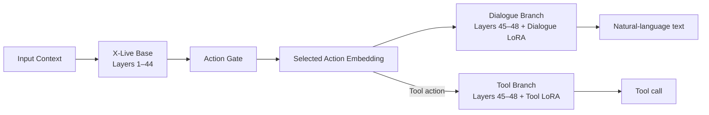

---
language:
  - zh
  - en
license: apache-2.0
base_model: HengtaoWu/X-Live-Base
library_name: transformers
pipeline_tag: text-generation
inference: false
tags:
  - conversational
  - function-calling
  - tool-use
  - vllm
  - lora
---

# X-Live Dual

<p align="center">
  <a href="https://github.com/HengtaoWu/xlive"></a>
  <a href="https://huggingface.co/HengtaoWu/X-Live-Base"></a>
  <a href="https://www.modelscope.cn/models/HengtaoWu/X-Live-Base"></a>
  <a href="https://huggingface.co/HengtaoWu/X-Live-Dual"></a>
  <a href="https://www.modelscope.cn/models/HengtaoWu/X-Live-Dual"></a>
</p>

X-Live Dual is a self-contained model for natural dialogue and asynchronous
tool use. It includes the complete X-Live Base weights and all Dual components;
no separate Base download is required.

## Transformers Quickstart

Install the dependencies:

```bash
pip install torch transformers peft accelerate safetensors huggingface_hub
```

Download the self-contained model repository and run the included Transformers
reference implementation:

```bash
huggingface-cli download HengtaoWu/X-Live-Dual --local-dir X-Live-Dual
cd X-Live-Dual
```

```python
from inference_transformers import XLiveDualForGeneration

model = XLiveDualForGeneration.from_pretrained(
    ".",
    device_map="auto",
)

result = model.generate(
    "Could you find me a nonstop flight from Shanghai to Seattle next Friday evening?"
)

print("Dialogue:", result.dialogue)
print("Action:", result.action)
print("Tool call:", result.tool_call)
```

Example output:

```text
Dialogue: Absolutely — I’ll look for nonstop options leaving next Friday evening.
Action: DELEGATE
Tool call: {
  "name": "delegate",
  "arguments": {
    "task": "Find nonstop flights from Shanghai to Seattle next Friday evening."
  }
}
```

This reference path runs the complete Action Gate, Action Embedding, Dialogue
branch, and Tool branch directly with Transformers. It is intended for simple
local inference and correctness checks. For high-throughput serving, use the
vLLM integration linked below.

## Architecture



The Action Gate predicts one of five actions:

- `NO_TOOL`
- `DELEGATE`
- `UPDATE`
- `INSPECT`
- `CANCEL`

Layers 1–44 process the context once. The Action Gate selects a learned
2048-dimensional Action Embedding, which is injected at the branch boundary.
Dialogue and Tool then continue through the final four Transformer layers with
different LoRA adapters.

The two branches decode concurrently. They have independent upper-layer KV
state, stopping conditions, and output lengths, so their tokens do not need to
align. The Dialogue stream is returned to the user, while the Tool stream is
parsed and dispatched to the backend. Gate decisions and Tool tokens never
enter the visible conversation history.

## High-throughput vLLM Inference

X-Live Dual requires a custom vLLM integration for shared prefill, branch-aware
KV management, and concurrent Dialogue/Tool decoding. The vLLM patch, launch
scripts, and usage are maintained in the
[X-Live repository](https://github.com/HengtaoWu/xlive/tree/main/src/xlive_vllm).

With the X-Live vLLM integration installed, the minimal launch command is:

```bash
XLIVE_MODEL_DIR=/path/to/X-Live-Dual \
XLIVE_DUAL_CHECKPOINT=/path/to/X-Live-Dual \
XLIVE_TP_SIZE=4 \
bash scripts/start_xlive_dual_model.sh
```

This starts an OpenAI-compatible text endpoint at
`http://127.0.0.1:8002/v1`. The same self-contained model directory is used as
both the backbone and the Dual checkpoint.

The vLLM integration performs the following steps for each request:

1. Prefill the shared Transformer layers once.
2. Predict the Action and inject its Action Embedding.
3. Fork branch-specific upper-layer KV state.
4. Decode Dialogue and Tool branches concurrently.
5. Stream Dialogue through the OpenAI response.
6. Validate the Tool output against the selected Action and publish it through
   the Tool side channel.

Stock Transformers or stock vLLM can load the included X-Live Base weights,
but they do not implement X-Live Dual branch execution.

## Model Files

```text
config.json                         X-Live Base configuration
model-00001-of-00013.safetensors    complete merged Base weights
...
model-00013-of-00013.safetensors
action_gate/                        five-action classifier
action_embedding.safetensors        invisible action conditioning
dialogue/                           Dialogue LoRA
tool/                               Tool LoRA
tokenizer.json                      tokenizer and Tool tokens
chat_template.jinja                 prompt format
system_prompt.txt                   frontend system prompt
tools.json                          Tool schemas
xlive_protocol.json                 runtime protocol
inference_transformers.py           minimal Transformers Dual inference
```

## License

X-Live Dual is released under the Apache License 2.0. Other runtime components
retain their respective licenses.
